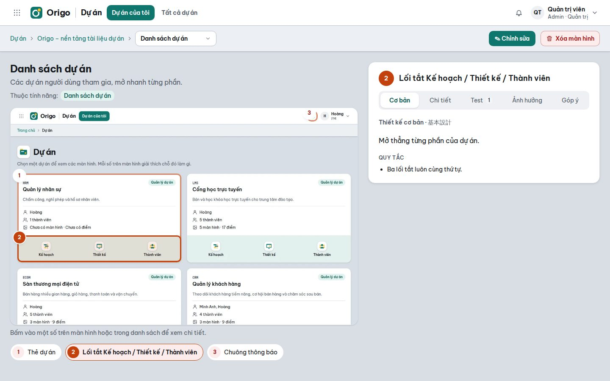
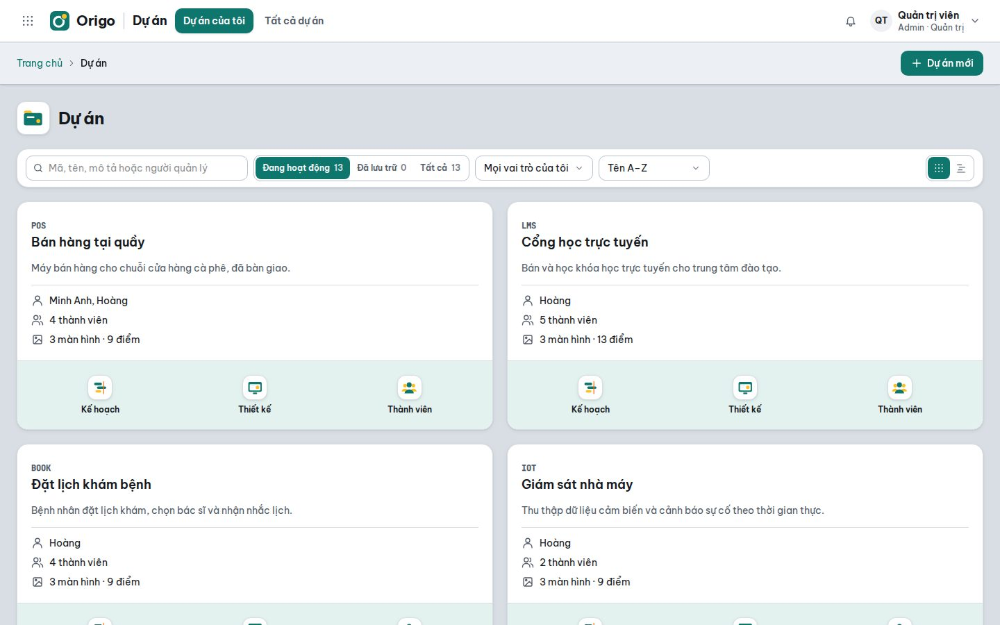
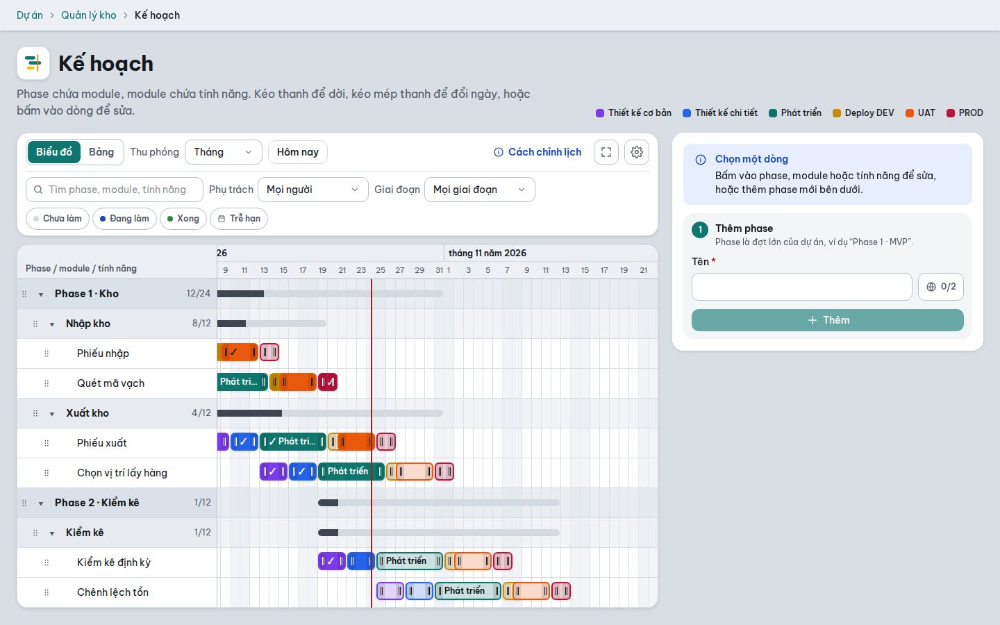
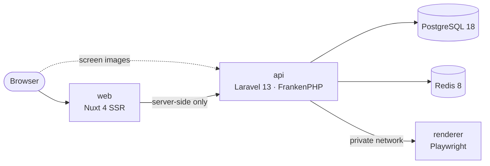

<div align="center">

<picture>
  <source media="(prefers-color-scheme: dark)" srcset="web/public/images/brand/origo-logo-on-dark.svg">
  
</picture>

### One place where a software team understands its product.

Screen maps with numbered design notes, project plans, and the discussion around them —
so developers know what to build, QA knows what to test, and BA/PO can review it all.

[](CHANGELOG.md)
[](https://laravel.com)
[](https://nuxt.com)
[](https://www.postgresql.org)
[](#-quick-start)

[Features](#-features) · [Quick start](#-quick-start) · [Production](#-production) · [Development](#-development) · [Contributing](#-contributing)

<br>



</div>

## ✨ Features

<table>
<tr>
<td width="50%" valign="top">

**🗺️ Screen maps**
Upload a screenshot, or let Origo capture one from an HTML/ZIP mock-up or a live URL. Pin numbered
points on it; every point carries its basic and detailed design, test cases, dependencies and impact.

**🗓️ Plans**
Phases → modules → features on a Gantt chart or a table, with your own stages (design, build, UAT…).
Drag to reschedule, filter by owner, stage or status, and present in full screen.

**💬 Collaboration**
Comment on any point and @mention teammates; a notification bell keeps everyone in the loop.

</td>
<td width="50%" valign="top">

**🔐 Roles and permissions**
Create your own system roles and project roles from a catalog of permissions. Built-in guards make
sure someone can always manage the settings, and every project keeps someone who manages its members.

**🌐 Multilingual content**
Vietnamese by default plus any languages you enable, with one-click machine translation. The interface
speaks Vietnamese, Japanese and English.

**🧭 Built for teams**
Archive or delete projects safely (type-to-confirm), light and dark themes, an illustrated in-app guide,
and a first-run install screen.

</td>
</tr>
</table>

<table>
<tr>
<td width="50%"></td>
<td width="50%"></td>
</tr>
<tr>
<td align="center"><sub>Projects at a glance</sub></td>
<td align="center"><sub>Plans with stages and progress</sub></td>
</tr>
</table>

## 🚀 Quick start

All you need is **Docker** with Compose v2 — no PHP or Node on your machine.

```bash
git clone https://github.com/phamle21/origo.git
cd origo/docker
cp .env.example .env
docker compose up -d --build
```

The first start installs the PHP and Node packages, so give it a few minutes. Then finish the
installation **one of two ways** — both create the database tables and your administrator account:

| | How |
|---|---|
| 🖥️ **In the browser** | Open **http://localhost:3310**. Until an administrator exists, Origo opens its install screen and asks for your name, e-mail and password. |
| ⌨️ **On the command line** | `docker compose exec api php artisan origo:install` — interactive; add `--email=… --name=… --no-interaction` for scripts (a temporary password is printed once). |

Once an administrator exists, the install screen closes for good.

| Service | Address |
|---|---|
| Web app | http://localhost:3310 |
| API health check | http://localhost:8310/api/health |
| Mail catcher (Mailpit) | http://localhost:8035 |
| Storybook — `docker compose --profile review up -d storybook` | http://localhost:6306 |

> [!TIP]
> Always run Compose from `docker/` **without** `-f`. A personal `docker/compose.override.yaml`
> (ignored by Git) is then merged automatically — handy for a local domain or keeping data elsewhere.

## 🧱 Architecture



- The browser only talks to the **web** app; its server calls the **API**, so tokens stay in an
  httpOnly cookie and the API address never reaches the browser.
- The **renderer** turns uploaded HTML or a URL into a screenshot. It sits alone on a private
  network that only the API can reach, and blocks private addresses by default.
- The API image also runs the **queue worker** and the **scheduler**.

| Folder | What it holds |
|---|---|
| [`api/`](api) | Laravel API, split into domain modules (`modules/Core/*`) and the HTTP layer (`modules/Application/ApiV1`) |
| [`web/`](web) | Nuxt app: pages, components, a server-side API layer (BFF), i18n, tests and stories |
| [`renderer/`](renderer) | Screenshot service with a network guard |
| [`docker/`](docker) | Development stack, production template and multi-stage Dockerfiles |
| [`scripts/`](scripts) | Release tooling |

## ⚙️ Configuration

Development settings live in `docker/.env` (ports, UID/GID, versions) and `api/.env` (created from
`api/.env.example` on first start). Images read every setting at run time, so one image serves every
environment.

| Variable | Used by | Purpose |
|---|---|---|
| `APP_KEY` | API | Encryption key — generated on first start in development |
| `APP_URL` | API | Public API address; screen images are served from it |
| `DB_*` · `REDIS_*` | API | PostgreSQL and Redis connections |
| `MAIL_*` | API | Outgoing mail |
| `INSTALL_TOKEN` | API | Code the install screen asks for; required to install from the browser in production |
| `AUTO_MIGRATE` | API | `true` applies pending migrations when the API container starts |
| `RENDERER_URL` | API | Internal address of the renderer |
| `NUXT_API_BASE_URL` | Web | Internal address of the API |
| `NUXT_ERROR_NOTIFY_*` | Web | Optional Slack / Google Chat alerts for server errors |
| `ALLOWED_PRIVATE_HOSTS` | Renderer | Private hosts the renderer may open (comma separated) |

## 📦 Production

Every release is published to GitHub Container Registry for `linux/amd64` and `linux/arm64`:

| Image | Role |
|---|---|
| `ghcr.io/phamle21/origo-api:<version>` | API, queue worker and scheduler |
| `ghcr.io/phamle21/origo-web:<version>` | Web app (port 3000) |
| `ghcr.io/phamle21/origo-renderer:<version>` | Screenshot service |

[`docker/compose.prod.yaml`](docker/compose.prod.yaml) is a ready-made stack with PostgreSQL, Redis
and persistent volumes:

```bash
cd docker
cp .env.prod.example .env.prod      # fill in every empty value and pin ORIGO_VERSION
docker compose -f compose.prod.yaml --env-file .env.prod up -d
docker compose -f compose.prod.yaml --env-file .env.prod exec api php artisan origo:install
```

Or install from the browser: in production the install screen asks for the `INSTALL_TOKEN` you set,
so nobody else can claim the first administrator account of a fresh server.

> [!IMPORTANT]
> Put an HTTPS reverse proxy in front of the web (`WEB_PORT`) and API (`API_PORT`) ports — sign-in
> cookies are secure-only in production — and back up the `api-storage` and `postgres-data` volumes.

<details>
<summary><b>Running on a platform with one app per image</b> (Easypanel, Coolify, …)</summary>

<br>

- Create PostgreSQL 18 and Redis services on the platform.
- Run the API image three times: as the web server (port 80), with the command
  `php artisan queue:work --tries=3`, and with `php artisan schedule:work`.
- Mount a persistent volume at `/app/storage/app` for all three.
- Run the web image on port 3000 with `NUXT_API_BASE_URL` pointing at the API's internal address, and
  the renderer image reachable from the API as `RENDERER_URL`.
- Use the API section of `docker/.env.prod.example` for the API apps and the Web section for the web app.
- Set `AUTO_MIGRATE=true` on the API web server only, or run `php artisan origo:install` once.

</details>

## 🛠️ Development

```bash
docker compose exec api php artisan test       # API tests
docker compose exec api vendor/bin/pint        # PHP code style
docker compose exec web yarn verify:quick      # format, lint, type check and unit tests
docker compose run --rm --no-deps renderer npm test
```

Start over with an empty database:

```bash
docker compose exec api php artisan migrate:fresh
docker compose exec api php artisan cache:clear
```

## 🏷️ Releasing

Origo follows [Semantic Versioning](https://semver.org/). `api/VERSION`, `web/package.json` and
`renderer/package.json` always carry the same number, and [CHANGELOG.md](CHANGELOG.md) records every
release.

```bash
docker login ghcr.io -u phamle21     # once, with a token that has write:packages
scripts/release.sh 1.0.0             # builds amd64 + arm64, pushes <version> and latest
```

The script stops if the three version numbers disagree or there are uncommitted changes. Building
arm64 on an amd64 machine needs QEMU once: `docker run --privileged --rm tonistiigi/binfmt --install arm64`.

## 🤝 Contributing

Contributions are welcome. Read [CONTRIBUTING.md](CONTRIBUTING.md) for the branch model
(`main` · `develop` · `feature/*`), commit style and the checks to run before a pull request.

## 📄 License

A license has not been chosen yet. The web app started from Nuxt SSR Starter by Ali Soueidan, used
under the [MIT License](web/LICENSE).
